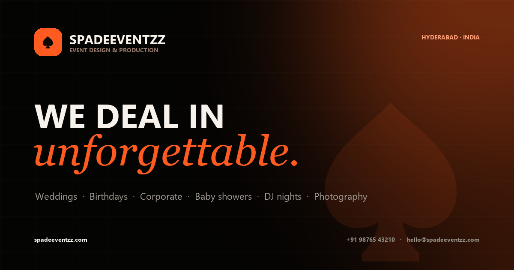

# Spadeeventzz — landing page

A modern, dependency-free landing page for **Spadeeventzz**, an event design & production studio in Hyderabad. Weddings, birthdays, corporate events, baby showers, DJ nights and corporate photography.

Design direction: obsidian black, ember orange and bone white, with editorial type, film grain, motion and a bento-style services grid. No frameworks, no build step.



## Preview locally

From this folder:

```powershell
python -m http.server 8081
# open http://localhost:8081
```

Any static server works — `npx serve`, VS Code Live Server, etc. A server is better than opening `index.html` via `file://` so relative paths and lazy loading behave like production.

## Files

```
spadeeventzz/
├── index.html            # landing page
├── 404.html              # custom not-found page
├── privacy.html          # privacy policy
├── terms.html            # terms of service
├── robots.txt
├── sitemap.xml
├── README.md
└── assets/
    ├── styles.css        # design system + all page styles
    ├── legal.css         # styles for the legal pages
    ├── app.js            # nav, reveals, counters, filters, dialogs, forms
    ├── favicon.svg
    ├── og-image.png      # 1200×630 social preview
    └── img/              # photography
```

## What's included

- Sticky nav with scroll-state, scrollspy and a full-screen mobile menu
- Editorial hero with rotating stamp, photo stack and pointer-reactive glow
- Infinite service ticker
- Bento services grid — all six offerings, each with an enquiry shortcut
- Studio section with animated stats and portrait collage
- Filterable portfolio grid with keyboard-accessible lightbox
- Four-step process timeline
- Three pricing packages with a highlighted “Most booked” tier
- Testimonials and an accessible FAQ accordion
- Orange CTA band and a full footer with newsletter capture
- Lead-capture modal with validation, event pre-fill, spam honeypot and success state
- Scroll reveals, counter animations and reduced-motion support
- SEO meta, Open Graph/Twitter cards, JSON-LD, favicon, sitemap and legal pages

## Customise

1. **Brand colours** — edit the CSS variables at the top of `assets/styles.css` (`--black`, `--orange`, `--white`).
2. **Copy** — all text lives in `index.html`; search for the section heading you need.
3. **Services & prices** — update the six cards in the services grid, plan prices in `#packages`, and the matching `<option>` list in the enquiry modal.
4. **Photos** — replace files in `assets/img/` with the same names (or update `src`). Keep landscape images ~1400 px wide and portrait images ~1200 px wide for fast loads.
5. **Contact details** — search and replace `+91 98765 43210`, `hello@spadeeventzz.com`, `@spadeeventzz` and the Jubilee Hills address across `index.html`, `privacy.html` and `terms.html`.
6. **Domain** — replace `https://spadeeventzz.com/` in the canonical/OG tags, JSON-LD, `robots.txt` and `sitemap.xml`.
7. **Social preview** — `assets/og-image.png` is generated art. Replace it at 1200×630 if you change the brand.
8. **Fonts** — Sora, Inter and Instrument Serif load from Google Fonts. For strict GDPR compliance, self-host the WOFF2 files and remove the Google Fonts links.

## Connect the forms

The enquiry and newsletter forms validate and show a success state but **do not send data anywhere** by default.

To connect an endpoint, add `data-endpoint="https://your-api.example.com/leads"` to `<form id="lead-form">`. The script will POST `FormData` and expects a 2xx response. The same pattern can be added to the newsletter handler in `assets/app.js`. Formspree, HubSpot, an API Gateway + Lambda, or a simple serverless function all work. Add reCAPTCHA/Turnstile and a consent line before launch.

## Before you launch

The design is production-ready; the content is a polished template. Replace or verify:

- [ ] Testimonials and client names are fictional placeholders
- [ ] Metrics (“350+ events”, “4.9/5”, “20+ cities”, “40+ crew”) are illustrative
- [ ] Package prices and inclusions
- [ ] Photo choices and usage rights (see credits below)
- [ ] Privacy policy and terms — reviewed by a lawyer for your jurisdiction
- [ ] Contact details, address, Instagram/WhatsApp handles
- [ ] Domain references if you do not own `spadeeventzz.com`
- [ ] Real form endpoint, spam protection and consent copy

## Photo credits

Photography is sourced from [Unsplash](https://unsplash.com) under the Unsplash License and stored locally in `assets/img/`. Swap in your own event photography before launch — real work will always outperform stock.

## Deploy

The site is fully static, so any of these work:

- **Netlify / Vercel / Cloudflare Pages** — drag the folder in, or connect the repo.
- **GitHub Pages** — push to a repo and enable Pages on the branch root.
- **AWS S3 + CloudFront** — `aws s3 sync . s3://your-bucket --delete`, then serve through CloudFront with HTTPS.
- **Any shared host** — upload via FTP to the web root.

Ensure `index.html` is served at `/`, HTTPS is on, and the domain matches the canonical/OG URLs.

## License

Site code is original work for the Spadeeventzz project. Fonts are licensed under the SIL Open Font License via Google Fonts. Unsplash images retain their respective licenses; replace them with owned photography for commercial launch.
